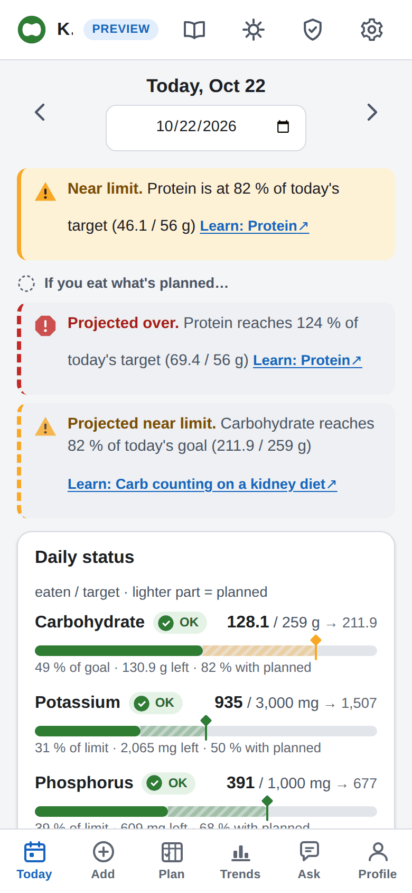
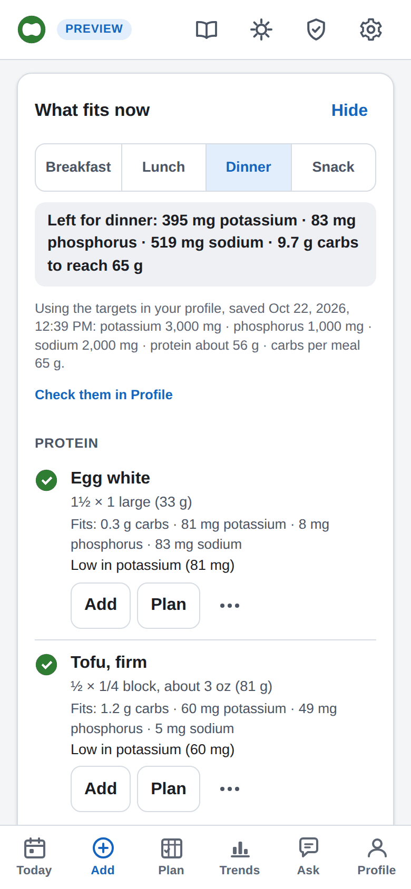
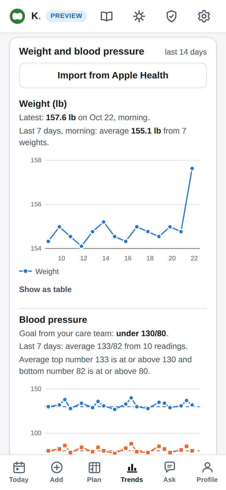
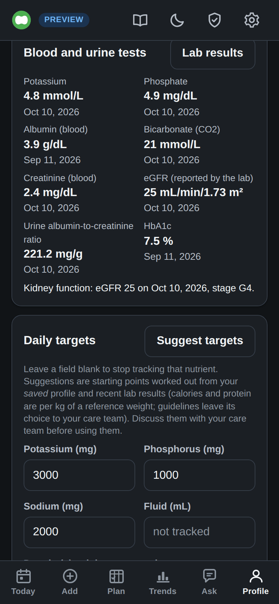

# Kidney Health

A food log for people living with chronic kidney disease (CKD), with extra help for those who also
have type 1 diabetes. You write down what you eat. The app adds up the things a kidney diet watches,
like potassium, phosphorus, sodium, protein and fluid, plus the carbs you count for insulin. It shows
how your day compares with the targets you set with your care team.

You run it on your own computer or home server, and everyone in the household gets their own login.
It works on a phone like a normal app, and your data stays with you.

## [Try the demo in your browser](https://ksullivan86.github.io/kidney-health/demo/)

Nothing to install and no sign-up. The demo runs entirely in your browser with a made-up person,
Sam, so you can click around and add food. Nothing you type is sent anywhere, and reloading the page
starts over.

<table>
  <tr>
    <td></td>
    <td></td>
    <td></td>
    <td></td>
  </tr>
  <tr>
    <td align="center">Today</td>
    <td align="center">What fits now</td>
    <td align="center">Trends</td>
    <td align="center">Lab results (dark mode)</td>
  </tr>
</table>

There is also a plain-language [patient handbook](https://ksullivan86.github.io/kidney-health/)
about kidney disease, eating well, lab results and living with type 1 diabetes and CKD.

**Please note:** this is not medical advice and not a medical device. Your targets should come from
your nephrologist or renal dietitian. The app never works out insulin or medicine doses, and it never
tells you to hold back on treating a low blood sugar.

## What it does

* **Food log.** Add food by searching about 400 common foods, scanning a barcode, copying a nutrition
  label or making your own. Each food gets a green, yellow or red rating before you save it, with a
  link that explains why.
* **Your targets.** Fill in your profile and the app suggests starting targets from published
  guidelines. Every number has a "Why this number?" note. Nothing is saved until you say so, and you
  can change anything to match what your care team told you.
* **Daily totals and warnings.** Today shows how close you are to each limit, including the food you
  have planned but not eaten yet.
* **Meal help.** "What fits now" lists foods that fit what is left of your day. It can suggest swaps
  with less potassium, phosphorus or sodium, plan the rest of the day, and it learns what you like.
  This part works without AI.
* **Treating a low.** A card with what to take for a low blood sugar, which also works offline.
* **Lab results.** Enter results in US or SI units and see your eGFR and kidney stage. You can also
  bring them in from a spreadsheet, the iPhone Health app, a patient portal file, or a photo or PDF
  of a report.
* **Weight and blood pressure.** Log them, bring them in from the iPhone Health app or send them from
  a phone shortcut, see them on charts, and keep the alarm and goal your care team gave you. A very
  high reading shows the handbook's advice on when to call 911.
* **Symptoms and visit prep.** Note symptoms as they happen, then print one page with your averages,
  latest labs, symptoms and questions to take to your next appointment.
* **Works offline.** Install it on your phone's home screen. Food you log without a connection is
  saved and sent when you're back online.
* **Your data is yours.** Export everything as a zip file (JSON and CSV your dietitian can open),
  move it to another server, or delete your account.

AI features are there if you want them, and off until an admin turns them on. They include an
**Ask** chat, meal ideas, and reading label photos and lab report PDFs. You can choose to keep the AI on your own home
network. See [docs/ai.md](docs/ai.md).

## Run it yourself

The app is a single container with one database file. It runs on Linux, including a Raspberry Pi 4
or 5. It only listens on the machine itself (`127.0.0.1`), so to use it from your phone you put a web
server with HTTPS in front of it.

### With rootless Podman (recommended)

```bash
git clone https://github.com/ksullivan86/kidney-health.git && cd kidney-health
mkdir -p ~/.config/containers/systemd
cp deploy/quadlet/kidney-health.container deploy/quadlet/kidney-health.volume ~/.config/containers/systemd/
python3 -c "import secrets; print(secrets.token_urlsafe(32))" | podman secret create kidney-secret-key -
$EDITOR ~/.config/containers/systemd/kidney-health.container     # set PUBLIC_URL and TRUSTED_PROXIES
systemctl --user daemon-reload && systemctl --user start kidney-health
sudo loginctl enable-linger "$USER"                                  # keep it running after you log out
journalctl --user -u kidney-health | grep 'FIRST-RUN SETUP'          # shows the one-time setup code
```

Open the address from that log line and enter the setup code. The code works for 60 minutes; to get
a new one, restart the service or run `podman exec kidney-health python -m app.admin setup-code`.
Pick a user name and a password of at least 15 characters (a few unrelated words is easiest). Then
fill in **Profile**, press **Suggest targets**, check them with your care team, and save. You can
invite the rest of the household from **Server administration** (the shield icon).

Put HTTPS in front of the app ([docs/https.md](docs/https.md)) so phones can install it and use the
camera. You can check that a release image is genuine with `scripts/verify-image.sh 0.15.0`
([SECURITY.md](SECURITY.md#verifying-the-image-before-you-run-it)). The full guide, with backups,
upgrades and troubleshooting, is [docs/deployment.md](docs/deployment.md).

### On your phone

Open the app's HTTPS address and sign in. On an iPhone or iPad, tap Share and then **Add to Home
Screen**. On Android, choose **Install app** in Chrome. More detail, including how offline logging
works: [docs/install-on-your-phone.md](docs/install-on-your-phone.md).

### On your own computer, for a quick look

You need Python 3.11 or newer.

```bash
git clone https://github.com/ksullivan86/kidney-health.git && cd kidney-health
python3 -m venv .venv && . .venv/bin/activate
pip install --require-hashes --no-deps -r requirements-dev.lock
uvicorn app.main:app --host 127.0.0.1 --port 8000 --no-proxy-headers
```

Open <http://localhost:8000> and enter the setup code printed in the terminal. The database is saved
in `./data-local/kidney.db`, which only you can read.

### Other ways to run it

There are ready-made files for Compose, rootless Docker and Kubernetes in `deploy/`, and a recipe for
running a local AI model next to the app. See [docs/deployment.md](docs/deployment.md).

### Upgrading

**From 0.14, 0.13, 0.12, 0.11 or 0.10:** back up `kidney.db` first
(`podman exec kidney-health python -m app.admin backup /data/before-0.15.0.db`), change the image tag
to `:0.15`, and start it. The first start updates the database. Nothing new is turned on for you.
What changed: [CHANGELOG.md](CHANGELOG.md#upgrading-from-014-read-this-first).

**From 0.9, 0.8, 0.7, 0.6, 0.5, 0.4 or 0.3:** do the same with the tag `:0.15`, and read the notes for each step:
[0.3 to 0.4](CHANGELOG.md#upgrading-from-03-read-this-first),
[0.4 to 0.5](CHANGELOG.md#upgrading-from-04-read-this-first),
[0.5 to 0.6](CHANGELOG.md#upgrading-from-05-read-this-first),
[0.6 to 0.7](CHANGELOG.md#upgrading-from-06-or-05-read-this-first),
[0.7 to 0.8](CHANGELOG.md#upgrading-from-07-read-this-first),
[0.8 to 0.9](CHANGELOG.md#upgrading-from-08-read-this-first),
[0.9 to 0.10](CHANGELOG.md#upgrading-from-09-read-this-first),
[0.10 to 0.11](CHANGELOG.md#upgrading-from-010-read-this-first),
[0.11 to 0.12](CHANGELOG.md#upgrading-from-011-read-this-first),
[0.12 to 0.13](CHANGELOG.md#upgrading-from-012-read-this-first),
[0.13 to 0.14](CHANGELOG.md#upgrading-from-013-read-this-first) and
[0.14 to 0.15](CHANGELOG.md#upgrading-from-014-read-this-first). The database updates all run in one start.

**From 0.2:** if your server updates itself (the old Quadlet file with `Image=...:latest` and
`AutoUpdate=registry`), replace that file with the one in `deploy/quadlet/` before the next update,
or pin the old image and stop `podman-auto-update.timer` until you're ready. The newer image has no
shell, so the old health check would keep restarting it. Then follow
[CHANGELOG.md](CHANGELOG.md#upgrading-from-02-read-this-first) and the steps above.

## The handbook

The app comes with a patient handbook at `/learn`. It covers kidney disease and its stages, eating
well (potassium, phosphorus, sodium, protein, fluid, carb counting, reading labels), lab results, type
1 diabetes with CKD, medicines, getting ready for dialysis or a transplant, and day-to-day life. The
warnings in the app link straight to the page that explains them, and it works without internet.

Every medical statement in it cites its source, such as KDIGO, KDOQI or the ADA, and was checked
against that source. **No clinician has reviewed it yet**, and each page says so at the top. If you
are a clinician and could review a section, that help would mean a lot
([CONTRIBUTING.md](CONTRIBUTING.md#clinical-content-policy-and-sign-off)).

## Privacy and security

* Nothing leaves your server unless an admin turns on a lookup (Open Food Facts, USDA) or an AI
  provider. Even then, each person decides for themselves whether to use it.
* Each person sees only their own data. Admins can't read anyone else's log.
* No tracking, no analytics, and nothing loaded from other websites.
* The container runs without root, with a read-only file system and no shell. Releases are signed,
  and come with a list of what's inside.

The details are in [docs/security.md](docs/security.md) and [docs/privacy.md](docs/privacy.md). To
report a security problem, see [SECURITY.md](SECURITY.md).

## Settings you'll most likely need

Settings are environment variables, and secrets are read from files. These are the common ones:

| Variable | Default | What it does |
|---|---|---|
| `PUBLIC_URL` | not set | The address people type, like `https://food.home.example.net`. Set it whenever you use a host name. |
| `TRUSTED_PROXIES` | `127.0.0.1,::1` | Which reverse proxies to trust. It depends on your setup ([docs/security.md](docs/security.md#4-proxy-trust-trusted_proxies-per-topology)). |
| `AUTH_MODE` | `local` | `local` for normal logins, `proxy` if a sign-in proxy handles it, `none` for one trusted device with no login. |
| `OIDC_ENABLED` | `false` | Sign in with Authentik, Google or another provider, one or several at once ([docs/accounts.md](docs/accounts.md#sign-in-with-authentik-google-or-another-provider)). |
| `SECRET_KEY_FILE` | made for you in the data folder | Used to encrypt saved API keys. Keep a copy with your backups. |
| `USDA_API_KEY_FILE` | not set | A shared key for USDA food search. People can also add their own. |
| `OFF_ENABLED` | `false` | Barcode lookups in Open Food Facts. |
| `AI_ENABLED` | `false` | The optional AI features ([docs/ai.md](docs/ai.md)). |
| `DATA_DIR` | `/data` | Where the database lives. |

Everything else is in [docs/deployment.md](docs/deployment.md#configuration). Most settings can also
be changed inside the app, under Server administration.

## How the targets and warnings work

Suggested targets are starting points from published guidelines (KDIGO, KDOQI, the ADA and the
Dietary Reference Intakes), worked out from your weight, age, CKD stage, dialysis and recent lab
results. The warnings on each food follow the cut-offs renal dietitians commonly use. Foods used to
treat a low blood sugar never get a carbohydrate warning.

The numbers and their sources are listed in [docs/targets-and-labs.md](docs/targets-and-labs.md) and
[docs/guidance.md](docs/guidance.md), and explained in plain words in the handbook. Some of the rules
are marked "expert opinion" and still need review by a renal dietitian
([docs/ROADMAP.md](docs/ROADMAP.md)).

## More documentation

* [docs/README.md](docs/README.md): every guide in one list.
* [docs/ROADMAP.md](docs/ROADMAP.md): what's planned next.
* [CHANGELOG.md](CHANGELOG.md): what changed in each version.
* [docs/demo.md](docs/demo.md): the online demo, and keeping your demo data in your browser.
* [docs/try-it-for-ckd.md](docs/try-it-for-ckd.md): a 45-minute walk-through of the demo for testers who know CKD, not software.
* [docs/test-the-full-app.md](docs/test-the-full-app.md): a walk-through of the full app on your own server, with the test accounts.

## Contributing

Bug reports, corrections with a source, docs, handbook pages and code are all welcome. Start with
[CONTRIBUTING.md](CONTRIBUTING.md) and the [Code of Conduct](CODE_OF_CONDUCT.md).
[ARCHITECTURE.md](ARCHITECTURE.md) describes how everything fits together, and
[docs/maintainers.md](docs/maintainers.md) covers releases.

```bash
python -m pytest                       # all the tests, no network needed
node tests/js/run_vectors.mjs          # checks the browser's copy of the rules matches the server's
python scripts/build_preview.py --pages build/demo   # builds the demo
```

<details>
<summary>Project layout</summary>

```
ARCHITECTURE.md           how the app is put together: API, data model, rules, screens
app/                      the server (FastAPI) and, in app/static/, the web app
  auth/                   accounts, sessions, invites
  migrations/             database changes, one step per file
  guidance/               meal help without AI
  ai/, mcp/               the optional AI features and the assistant connection
  static/                 index.html, js/, css/ and the vendored barcode and PDF readers
data/                     the built-in food database
deploy/                   container files, Compose, Quadlet and Kubernetes examples
docs/                     guides for running and using the app; docs/dev/research holds the design notes
handbook/                 the patient handbook, served at /learn
scripts/                  building the food database, the demo and the handbook; image checks
tests/                    the test suite
tools/e2e/                browser tests that are run by hand
```

</details>

## Disclaimer

This software helps you keep a log. It is not medical advice and not a medical device. Nutrient
targets, limits and warnings must come from your nephrologist and renal dietitian, and insulin
decisions from your diabetes care team. The food data comes from the USDA and, if turned on, Open
Food Facts, which anyone can edit, so check labels and portions. Never delay or under-treat a low
blood sugar because of a potassium or phosphorus number.

## Licences

* **Code:** [PolyForm Noncommercial License 1.0.0](LICENSE). You can use, copy, change and share it
  for personal and other noncommercial use, for free. **Commercial use needs the author's written
  permission.**
* **Handbook text** (`handbook/docs/`, `handbook/includes/`, `handbook/data/`):
  [CC BY-NC-SA 4.0](handbook/LICENSE). Clinics, charities and families may copy, print, translate and
  adapt it for noncommercial use, with credit and under the same licence.
* **Food data:** USDA FoodData Central is public domain (CC0 1.0). Open Food Facts data, when turned
  on, is under the [Open Database License](https://opendatacommons.org/licenses/odbl/1-0/), and the app
  shows the credit with each product.
* **Third-party code** keeps its own licence: the barcode reader is MIT and Apache-2.0, and the PDF
  reader (pdf.js) is Apache-2.0. See [app/static/vendor/README.md](app/static/vendor/README.md).
